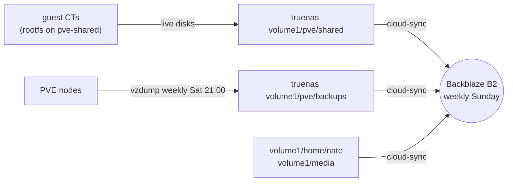

# Backups

What is backed up, where it goes, and the gaps that remain.



## vzdump

One cluster job (id `backup-6b4b8255-4743`): weekly Saturday 21:00,
all guests, storage `pve-backups` (the truenas NFS export),
snapshot mode, zstd, prune keep-last=4 keep-monthly=3. New guests
are covered automatically.

```sh
pvesh get /cluster/backup-info    # verify the job on any node
```

Failure notifications go to PVE's notification system, whose only
target is mail-to-root -- silent unless postfix relays. This is a
known gap; the fix is a PVE notification target or the v4 alerting
tier ([OPS-29](../plans/stories/OPS-29-grafana-dashboards.md) design).

## TrueNAS snapshots

Four periodic snapshot tasks, daily 00:00, two-week lifetime,
auto-pruned: `volume1/pve/shared`, `volume1/pve/backups`,
`volume1/home/nate`, `volume1/media`. Snapshots of pve-shared
capture live disks mid-write: crash-consistent, not app-consistent.

## Offsite: B2 cloud-sync

Five tasks (one per leaf dataset), weekly Sunday, PUSH/SYNC,
contents and file names encrypted, snapshot=True; the pve/shared
task excludes `/images/**` (live raw disks are crash-inconsistent
and dominate the byte count; the vzdump artifacts in pve/backups
are the restorable form). Bucket: `funkybooboo-truenas-backup`.
The encryption password and salt live only in the TrueNAS
middleware database; without them the B2 copy is unrecoverable.

TrueNAS alerts at WARNING and above reach the phone via the ntfy
alert service (verified live).

## Gaps

- **Single pool holds live disks and backups.** If truenas dies,
  live state, vzdump artifacts, and snapshots go together. The B2
  copy is the only off-box copy. PBS (OPS-14, v4) adds a second
  restore path with restore drills.
- **SYNC means mirror**: locally-deleted files leave B2 on the next
  run. Retention would need COPY mode or `--backup-dir`.
- **The restore path is untested end-to-end.** A backup counts only
  after a quarterly restore drill (OPS-14 acceptance).

## The old-fleet archive

The 187 vzdumps of the old fleet stay on pve-backups untouched.
What is in them and how to pull data back:
[archive.md](./archive.md).
