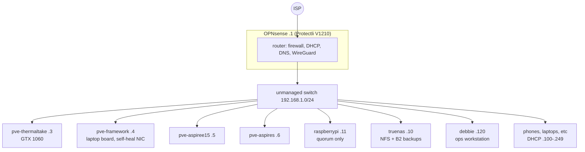
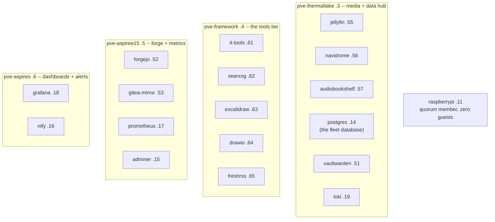
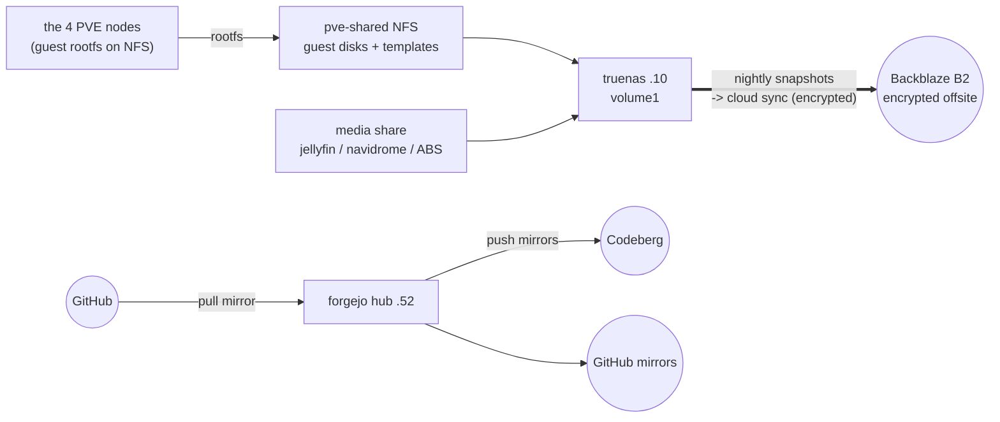

# Diagrams: the homelab at a glance

The visual atlas. One page, five pictures, all current as of
2026-11-28. The data behind them lives in
[ansible/inventory/](../ansible/inventory/) and the guest
manifests; the narrative lives in
[network.md](./network.md). When reality changes, change these
the same commit.

## 1. The physical network

Five machines, one flat LAN, one router, one switch.

## 2. Every packet's path (the privacy posture)

The operator directive made real: everything in or out of the
house rides Proton; the ISP sees one encrypted stream.

- The ISP sees: one WireGuard stream to Proton. No sites, no
  DNS, no traffic patterns.
- Quad9 sees: the domain queries (no-log, malware-filtering;
  that is the trade on record).
- A tunnel flap slides the house to raw WAN automatically; the
  DNS leg stays TLS-encrypted even then.

## 3. Who runs what (service placement)

Framework is the tools tier; thermaltake is media + the data
hub; the Aspires carry the build/observability layer; the Pi
holds quorum.

(All guest rootfs disks live on pve-shared NFS, so any guest can
land on any node; this placement is the current intent, not a
constraint.)

## 4. The tailnet overlay

Away from home, every device reaches every service by name over
WireGuard, exiting through the house.

- Away traffic that uses the exit node exits via the same Proton
  path as the house.
- Every guest enrolls in the tailnet at converge; UI-facing
  services get a serve front from their manifest.

## 5. Storage + the backup path

- Media files are the tier-0 data; metadata lives in databases
  (derived, restorable).
- The mirror chain: GitHub canonical -> forgejo hub on-cluster ->
  two external mirrors.

## How to read the five together

Picture 1 is where things physically are; picture 2 is where
packets go; picture 3 is which machine does which job; picture
4 is how the house is reached from outside; picture 5 is where
the data lives and how it survives a house fire. If a change
touches more than one picture, that change is probably one worth
a second look.
