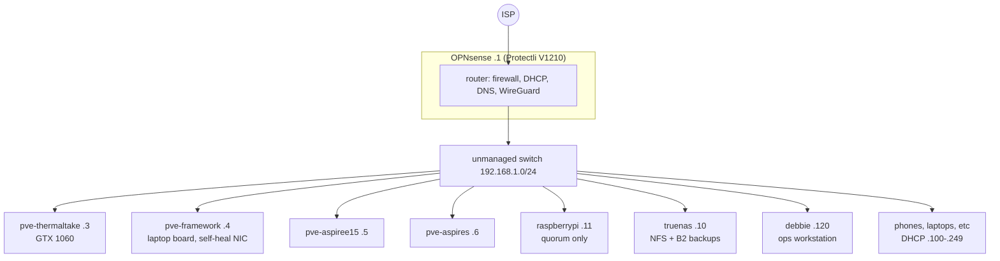
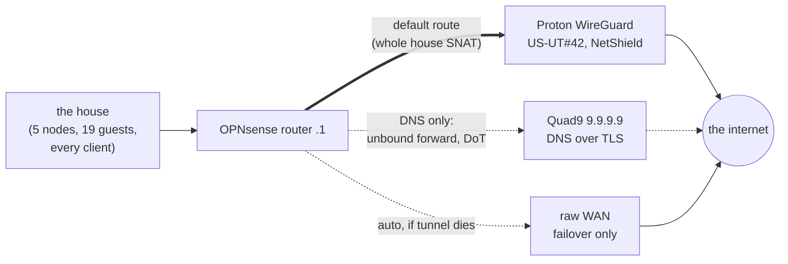
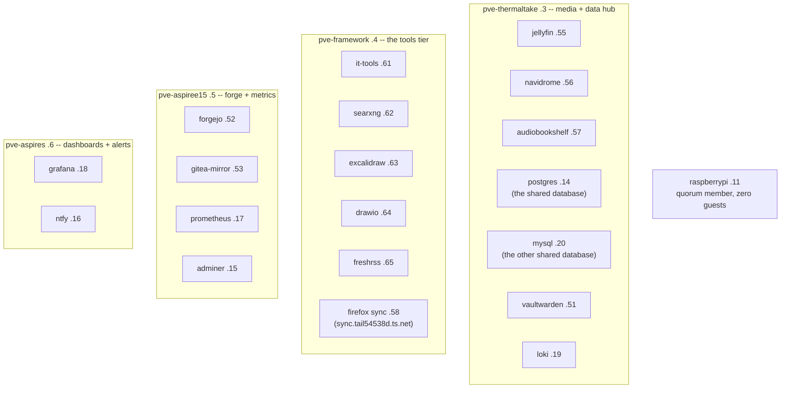
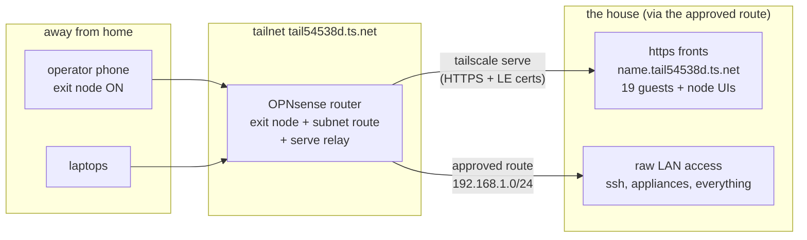
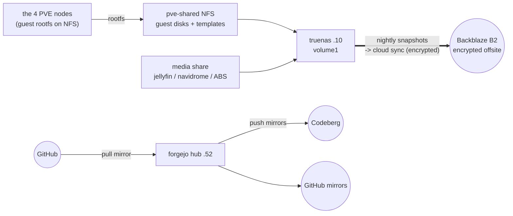

# Diagrams: the homelab at a glance

The network and the fleet as pictures, all current as of
2026-11-28: five diagrams plus the narrative they compress.
The data behind them lives in
[ansible/inventory/](../ansible/inventory/) and the guest
manifests; addresses live only there. When reality changes,
change this page the same commit.

## 1. The physical network

Five machines, one flat LAN, one router, one switch.

## 2. Every packet's path (the privacy posture)

The operator directive made real: everything in or out of the
house rides Proton; the ISP sees one encrypted stream.

- The ISP sees: one WireGuard stream to Proton. No sites, no
  DNS, no traffic patterns.
- Quad9 sees: the domain queries (no-log, malware-filtering;
  that is the trade on record).
- A tunnel flap slides the house to raw WAN automatically; the
  DNS leg stays TLS-encrypted even then.

## 3. Who runs what (service placement)

Framework is the tools tier; thermaltake is media + the data
hub; the Aspires carry the build/observability layer; the Pi
holds quorum.

(All guest rootfs disks live on pve-shared NFS, so any guest can
land on any node; this placement is the current intent, not a
constraint.)

## 4. The tailnet overlay

Away from home, every device reaches every service by name over
WireGuard, exiting through the house.

- Away traffic that uses the exit node exits via the same Proton
  path as the house.
- Every guest enrolls in the tailnet at converge; UI-facing
  services get a serve front from their manifest.

## 5. Storage + the backup path

- Media files are the tier-0 data; metadata lives in databases
  (derived, restorable).
- The mirror chain: GitHub canonical -> forgejo hub on-cluster ->
  two external mirrors.

## The narrative behind the pictures

**The Proton blanket (operator directive, 2026-11-28).** Every
packet in or out of the house rides Proton WireGuard: the
router's default gateway is the tunnel (NetShield
ads+trackers variant, US-UT#42), the whole LAN is SNAT'd to the
tunnel address, and the WAN stays armed as automatic failover
("Gateway switching"; the election happens at startup/interface
triggers, so flag changes want a reboot to arm). Local traffic
stays local. The operator chose blanket over the recommended
policy-split -- the reversal is on record in OPS-28 and
issues.md. Away devices selecting the router's exit node
inherit the same Proton exit.

**DNS rides the same posture.** The router's unbound forwards to
Quad9 (9.9.9.9) over DNS-over-TLS, cert-pinned to
dns.quad9.net -- one no-log, malware-filtering party resolves
for the whole house; the ISP sees only the WireGuard stream,
and a WAN failover keeps the DNS leg TLS-encrypted.

**Boot order (a law, identity rule 7).**

1. **truenas first** -- NFS must exist before guests boot.
2. **then the PVE nodes** -- quorum before workloads.
3. **then the guests** (onboot / converge).

Power-down is the reverse. The router sits before all of this;
the reboot runbook is
[scripts/reboot-node.sh](../scripts/reboot-node.sh), one node
at a time.

**Planned (already drawn as dashed lines where applicable).**

- PBS VM at `.12` (OPS-14, v4).
- The router's OPNsense 26.1 upgrade closes v3 (deliberate
  window, config backup first).
- Tailnet names as the fleet's universal addressing (the v4
  opener) -- guests still address each other by LAN IP today.
- Router re-platform onto Proxmox + the Pi's QDevice re-role
  (v5).

## How to read it

Picture 1 is where things physically are; picture 2 is where
packets go; picture 3 is which machine does which job; picture
4 is how the house is reached from outside; picture 5 is where
the data lives and how it survives a house fire. The narrative
section carries the rules the pictures cannot (boot order,
the directive record). If a change touches more than one
picture, that change is probably one worth a second look.
