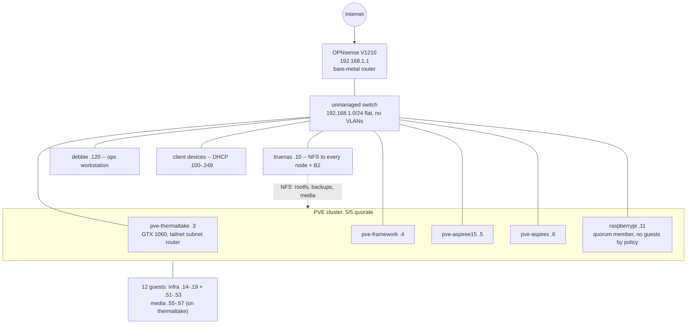
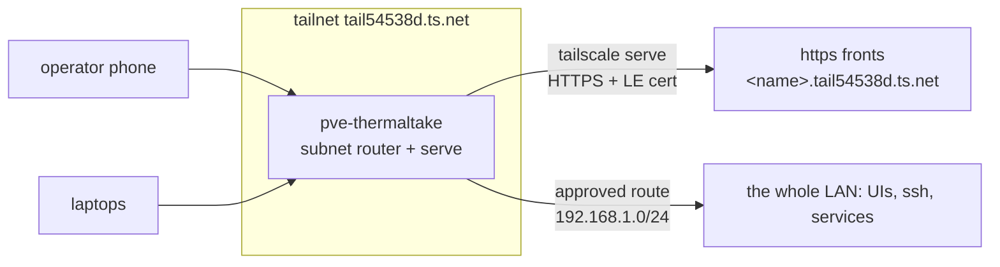

# The network: LAN, tailnet, boot order

Addresses live in one place: `ansible/inventory/group_vars/all.yml`
(LAN plan) + `host_vars/*.yml` (per-machine registry). This page is
the picture, not the data.

## The LAN

Reserved: `.12` (future PBS), `.13` (optional future subnet-router
guest). The DHCP pool `.100-.249` is for clients only; infra is
static everywhere.

## The tailnet overlay

One subnet router covers the whole LAN; WireGuard end to end, zero
inbound router ports. Every guest enrolls in the tailnet at
converge; UI-facing guests get an https serve front from their
manifest's `tailnet_serve` port. Guests talk to each other over LAN
IPs, not MagicDNS names (userspace tailscaled hooks neither the
guest resolver nor outbound routing).

## Boot order (a law, identity rule 7)

1. **truenas first** -- NFS must exist before guests boot.
2. **then the PVE nodes** -- quorum before workloads.
3. **then the guests** (onboot / converge).

Power-down is the reverse. The router sits before all of this;
the reboot runbook is [scripts/reboot-node.sh](../scripts/reboot-node.sh),
one node at a time.

## Planned

- PBS VM at `.12` (OPS-14, v4).
- Router re-platform onto Proxmox and the Pi's QDevice re-role
  (v5).
- The tailnet exit node on the router (OPS-28, operator decision
  pending).
