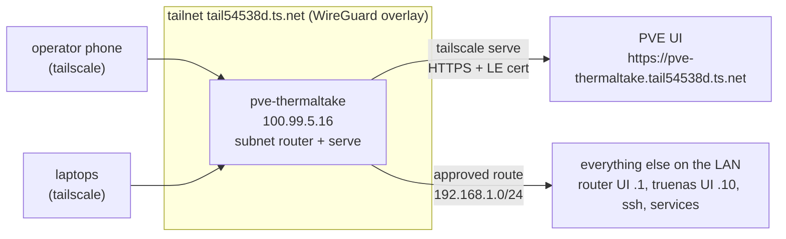
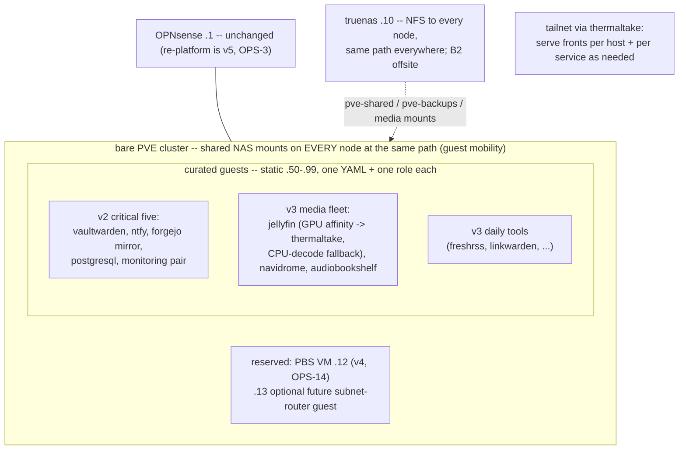

# The network: now and planned

The flat 192.168.1.0/24 LAN behind OPNsense, the PVE cluster + truenas
on it, and the tailnet overlay that is THE access layer. Addressing
lives in one place -- `ansible/inventory/group_vars/all.yml` (LAN
plan) + `host_vars/*.yml` (per-host registry); this page is the
picture, not the data.

Diagrams are mermaid; GitHub renders them inline.

## Now (2026-11-22, v1 shipped + tailnet access live)

```mermaid
flowchart TB
    ISP((Internet)) --> RT["OPNsense V1210<br/>192.168.1.1<br/>bare-metal router (unchanged until v5)"]
    RT --- SW["unmanaged LAN switch<br/>192.168.1.0/24 flat, no VLANs"]

    subgraph NODES["PVE 9.2 cluster -- corosync on the LAN, 5/5 quorate, HA master = thermaltake"]
        TT["pve-thermaltake .3<br/>GTX 1060 GPU<br/>tailnet 100.99.5.16"]
        FW["pve-framework .4"]
        A15["pve-aspiree15 .5"]
        ASP["pve-aspires .6"]
        RPI["raspberrypi .11<br/>witness only"]
        GHOSTS:::pending["old-fleet remains:<br/>5 CTs + 4 templates + 24 HA orphans<br/>removed by OPS-20"]
    end

    TN["truenas .10<br/>TrueNAS 25.10 -- NFS + B2"]
    DEB["debbie .120 wired / .103 wifi<br/>ops workstation"]
    CLIENTS["client devices<br/>DHCP pool .100-.249"]

    SW --- TT
    SW --- FW
    SW --- A15
    SW --- ASP
    SW --- RPI
    SW --- TN
    SW --- DEB
    SW --- CLIENTS

    TN -. "NFS pve-shared (CT rootfs)<br/>+ pve-backups (vzdump)" .-> NODES
    TN -. "B2 cloud-sync, Sunday 00:00" .-> B2(("Backblaze B2"))
    classDef pending stroke-dasharray: 5
```

Reading notes:

- **The old-fleet remains** (dashed) are still on the cluster: CT 101
  running as an HA auto-start artifact, 102/110/116/132 stopped, 4 VM
  templates, ~24 config-less HA orphans. OPS-20 removes them after the
  tier-0 extraction lands.
- **No guest IPs are in use yet** -- the static guest range .50-.99
  fills in v2. Reserved: .12 (future PBS), .13 (optional future
  dedicated subnet-router guest; thermaltake covers it today).
- Stale revival leftovers still present (removed by OPS-22): debbie's
  .8.99 alias, thermaltake's .8.98 alias.

## The tailnet access layer (OPS-21, live)



One subnet router, not per-node tailscale: the whole LAN is reachable
through one approved door, WireGuard-encrypted, zero inbound ports on
the router. `tailscale serve` adds the HTTPS + LE-cert layer for the
PVE UI (and any future service that needs an outside front). The
old per-CT tailscale model is what the 30-device graveyard being
purged grew out of.

## Planned (v2/v3: the fleet rebuilt as code)



What changes vs now: the cluster is bare (no ghosts), the curated
services exist as code-built guests in .50-.99, every node offers the
same NAS mounts so any guest can land anywhere and HA can move it,
and jellyfin prefers thermaltake for the GPU without being caged to
it. What does NOT change: the LAN, the router, truenas, the tailnet
model -- v2/v3 fill the middle; v5 revisits the platform (router
re-platform, Pi QDevice re-role, native balancer).

## Boot order law (identity rule 7)

1. **truenas first** (on the UPS) -- NFS must exist before guests boot
2. **then the PVE nodes** -- quorum before workloads
3. **then the guests** (HA auto-start / converge)

Power-down is the reverse: guests, nodes, truenas.
