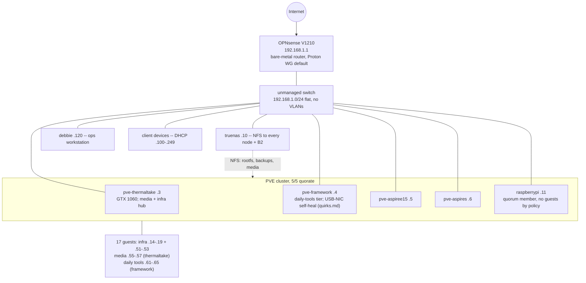
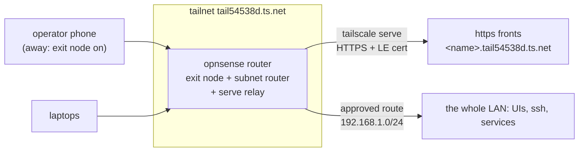

# The network: LAN, tailnet, Proton egress, boot order

Addresses live in one place: `ansible/inventory/group_vars/all.yml`
(LAN plan) + `host_vars/*.yml` (per-machine registry). This page is
the picture, not the data.

## The LAN

Reserved: `.12` (future PBS), `.13` (optional future subnet-router
guest). The DHCP pool `.100-.249` is for clients only; infra is
static everywhere.

## The tailnet overlay

The ROUTER owns the tailnet's LAN presence: exit node advertised
(away devices route ALL their traffic through the house, exiting
via the Proton blanket), subnet route 192.168.1.0/24 approved and
primary, and the tailscale serve relay. thermaltake's old subnet
advertisement is decommissioned -- one owner, the right one. Every
guest enrolls in the tailnet at converge; UI-facing guests get an
https serve front from their manifest's `tailnet_serve` port.
Guests talk to each other over LAN IPs, not MagicDNS names (the
tailnet-names-everywhere rework is the v4 opener).

## The Proton blanket (2026-11-28, operator directive)

Every packet in or out of the house rides Proton WireGuard: the
router's default gateway is the WG tunnel (NetShield
ads+trackers variant, US-UT#42), the whole LAN is SNAT'd to the
tunnel address, and the WAN stays armed as automatic failover
(System > Settings > General, "Gateway switching"; election
happens at startup/interface triggers, so flag changes want a
reboot to arm). House egress verified at 74.63.204.212. Local
traffic stays local; LAN-to-LAN never touches the tunnel. The
operator chose blanket over the recommended policy-split (the
split design + the reversal are on record in OPS-28 and
issues.md). Away devices that select the router's exit node
inherit the same Proton exit.

**DNS rides the same posture** (2026-11-28, operator
directive): the router's unbound forwards to Quad9 (9.9.9.9)
over DNS-over-TLS, cert-pinned to dns.quad9.net -- the whole
house resolves through one no-log, malware-filtering party;
the ISP sees only the WireGuard stream, and a WAN failover
keeps the DNS leg TLS-encrypted. Verified by resolver-identity
lookup (whoami.akamai.net returns Quad9 egress).

## Boot order (a law, identity rule 7)

1. **truenas first** -- NFS must exist before guests boot.
2. **then the PVE nodes** -- quorum before workloads.
3. **then the guests** (onboot / converge).

Power-down is the reverse. The router sits before all of this;
the reboot runbook is [scripts/reboot-node.sh](../scripts/reboot-node.sh),
one node at a time.

## Planned

- PBS VM at `.12` (OPS-14, v4).
- Router re-platform onto Proxmox and the Pi's QDevice re-role
  (v5). The router's OPNsense 26.1 upgrade closes v3 (deliberate
  window, config backup first, oxlorg release paired).
- Tailnet names as the fleet's universal addressing (v4 opener,
  operator directive 2026-11-28).
